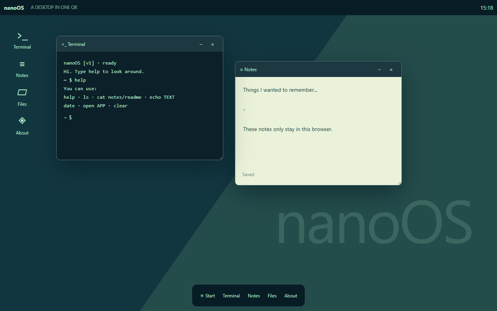
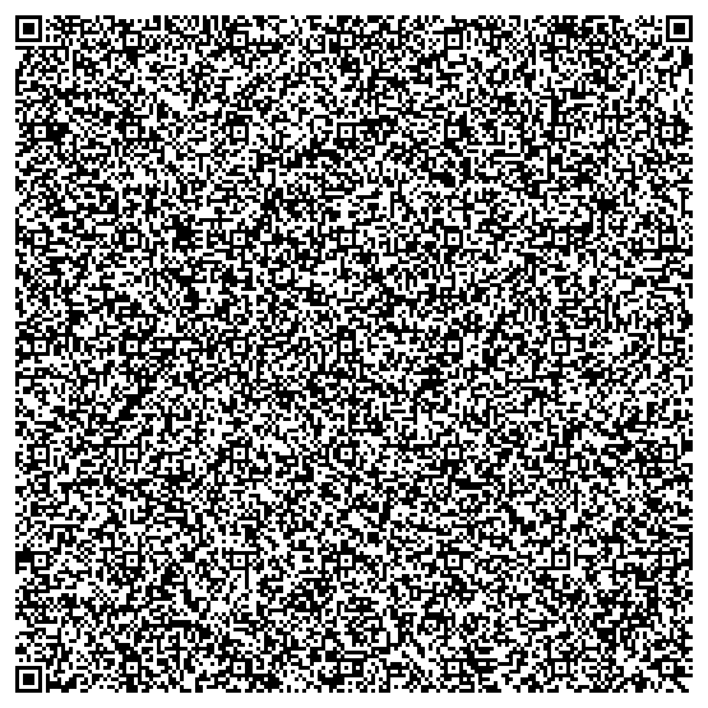

# nanoOS

### A tiny desktop inside one QR code

By **Eeshan N**

I wanted to see how much of a desktop I could fit into a single QR code. This is what I ended up with: movable windows, a terminal, notes, files and a clock.

[Open nanoOS](https://eeshanwinner-arch.github.io/nanoos/#1:GVLIJ$J1GLR237*2.RU5RAUT5QSK//FTWYA/YB-TPBRJAF/QMAMT3Y4:S15VNIBD7WHQAHQDD7WX5PHY:AD9N0S1BEQD4UT:TKWI7TM:6O99D.8JGHVSTV47K5/RFYLJDID5G-K7:5UTSD$KB2VP7Y7UCNOD599KCYAKAPWWLA355*QJR5WYL2CA:0MCRS5KGDBF*GICQ968L*F2VYMX9YD.GVIHJZT+Z1/28Z4W4UGGIJBR970MSVNOBD2IV4HLZTWVPC/XEU1D$ZR8:K0V2-OS81JW-4N7O5.XJIM+FS6C7FUJD84PYNT.S7XD:FF0RQ:HHNWL16R2NPZ56S1RWRXE*H2PL$KT8C3:+UR1B*FNQ*IWHPDOB06Q352OASR5CRTU:PLEGKGYRBELF*JCTURD61GE1JRJOJ7QEQ*D/S4HLD.HKNTD8VXK69N-BDFV049RRJ8Y5*55.VC+6P26Q65CLMI*CU4EB2:CUN5-$TSTLBA6081D5WZNQEY1.K52LF4*8.I309A*:NNAWJ11AXH7VK.0S5TDQUB8JGFFS.MSISJ-S8FFL7*N0YY$IV4VXGDAAPOE5VDM0MGBK6Q:WO.0PF+JF7HBVDM1A.57T+R845CXEB57NE323F4$91S00ACLOCBUB$TJ2/SFOC/*RZLF8DD+U2XXH-RGD2XORI+.HT.EU/XA-O*4LQ$G5TSCW4SJO86F7+AR3Y9A9D4QTQ4US241LMT4QSGQ+A+JFL492PPL7W1HE+0B0Q9*.Y4+4HLAJBQ8BB*16/1HZH3I4I6GGRQQP8TY10NCDR0A.FFPHCL84YNW/QM015-JOT9LEN03F1HH2-RQ$DSR8SPDPM.F4BTVJ9GYUY.HF2MJK5GUILXJ9AQ6PAS5QKK2VTWVHF2E6/8Q2NGD.QQYEJV8IPK597Q.5:GAWZ6N.1.-8:UB-S4CDB.LRFU1/C4:X2QU9D4UKKIULTU8S09E6P8B84APO/DMFVW.FB.L9Y:Q::L61CWWE2GH0HLHVL5CY*3OH6A1A7E6L4DH1KPUJVIAN4*DKPHZFICIYDU45679U147TRKC908:PX--YFQLYU3*4T5627OSZ.S-4LAQF:-ZC:7C58U/RKKXOFHUSFON7*P1/ZWIG8LTRD0EHW07KF-*U9N46W94B4HFJ*GFH8AF6ATL4INNY1M4XEY93M:TTO5GE9KG0G/6FF5SKVNU10S5G:DZLR2JX6D36PC/.5OR6EGQ8-C2HE5D22GJ/UFCFNZIL-92P-H/5HV2GVV3RX9Y:7PQP-MOE54XP6S-V7768KJ5DHBJIJ:B/+8KY5K3A.UM0TLDTJ85Q5QH+RU1UVM$XOL7W527W5T/EKEC8SWPUI/L5-PPX:Z2:0.NX8+IEDRRNPX2MCWF+REHZ5A*7PMFP*QJYH14I+N87/0M:F0ZAV19*:XG.JHRZH2X/FB/OGB3SM.TETCFEMM:R4EE/LO.V1K91F.UJ$Y-1QS:ODQ1P10ZX4*LUENYT.J4OGF:77P8PPV5I0CRIZV5IOKKAA1S3O7FXKR4JYS.BB1R5ZW+WUIAU.$BGKBIFL8HI7$GVEGP948+QTGTQ7RK4J8DG27XJ$C+WJWITIOVOAOIUSCFJVTJVZL1CSL+NAISRQQ85EDYR.0PIGVS.9*.74SRP2MLRRU5LG54-I0W639XV5JS9CRA4PV1ME513VFORFYVLCC2P4KAJOWAQY8H/VIO8UD-AZV22ZJQWSQI86XL3BNH7G68M0MYDUZD-M682.I6VCQRPYO+M4Y2P08TYPRC8J0ARCGWLNDO812W7E4MIVCEO+ESM5VV0QQW6NA1$V5N5HY4JC-82V1A6SAKQ49A7.HWT5GUTS:AA0OO$BH14:TQ*N8O2517GT30F17PUJGBK/5M5/3--DBVLY2205Q8OMDX4K$HKYAZUO/AA9XYQ-XNCM03N6KDK31PD9$*D2$0AYI-1P7A7ZH9JH0DPNOBX1FG0ZKE$3.CAA7229J9+ACV2HPAF65LY7+HXK49D2Q7ROJ0B+LN4RKS-VK24$TQQXVW/B08T5HDX8BSBT:QB:RESCLDIFL+MQ:5$WO7GRVGXAPA9-KG3JY1OR9D9FP:FG41W-6OX16:FKQPNJ+B6T86$LEUPR/5AD9K0ZGVVUSYAAB:W5EXFXO25LTZMR-D7H:360PUBL+IJ0TWR.M4MH2G5VX0RFWJ7LU1QDCAG84LTT36702M58E0E33YWD-V-Y0JOW8/WC:WBYWB2DBGFN-AJBGE:G7:MX1EJ8XKV3XCHW2PE0MH7M$2AEBB$3Z61V$/XM09*+6MWO3IF-$97KAWHM7.HQ9QC$MGSDNBY82P/SJVWKBAHTP47WLDH10*7*LU/840W8VCT+6MGFWC-QUL8GZW/PWXO4S41.A52/2SA2Q45Y66E76TGE4OPP5R--QGU6S:W5NBRIX/E7T0Y-LED.Z69Y-VH+69V7X**D/OEMJEPVD-L2MUGPD5ACFMERWAEZ9A171DSBQPG:DW+9UJDJ/$2RW0W+Z7/MVDM8/G8:QC7YK4GCQWMFM:CHT:CZNC5Q5IW5EAEE4OYWZ4JVM3GGS6R4DDC5KVK8AE-B0GIH*M6/MDCKWH1Z0ICTF4:NY9WNWXZCHONFZEMAN16N2UMY2M$XT-5HOUCJ0DHY9+547KJURH1IR0F/R96PVB*QC7YC4KRZI*2UPE1TWS9TON8EL9OPSA.U96W3MZ2I423$I73XX1UR$N6C9Z601D04VQB9QB06C7QMSGXN1EKH-XX72WVFE:ON/-2W:I3XWAW53NHMUPN1P-5LL8FHRW5VI+VFF76Y4I9Z0:2FC6H1KIO619E1HQ3A5V038REIXAVTSGHJ9:RSQOP+OYNS3JPORCUYH4OLFG3RH26-WF+ZGR-O3PW9SRUMPPJGT032L7ZKSTMTIBN2ZNQ*DDUMR1JRF482AL3B4Z4TLGSKK.GSXC2.*OD/9CZFQ5FFAIMSJ1SXYQ4G.PNO192V6YTWFUB:2-Z2NU8AYOA*B9A6HEW2.X9VTNJ4V-D1UP0YH37X9GPYNLFYZ8S2/FIO8OK3ANHRD+93QWHWMHIKV:J1RF.WGPK5X37:.EM016DZH03T86/GLHI9$A2OLF9UXQZ8R2N2KR69QMF070PL*VZXAD.XWQQMYDBAJL-W:YKT9KCVX93GNV7.W2:DW3VGF03ZHGY-798ERNQI5ID-K91QET15:X4$OQCBJ4SHREC7GOG4U85P*M4XI*XZ7-BK52GRIAS7BH5E.0FPMBG2I/Z1NB+J1A3AF8IZ52L*84UU.:7W1V836-PO5ZK+TB0T1K$G7V6Z2YS7MS$U9WJR*KFLBR:7TU7SLR:$G357BCXWBJS6FXE3.PHFBKZWIDSNXXMUNNKH6/EFIBOS*JO34/BK3+MOZQ4O72+4YM4G.SS$PZC0WB7S9E6.M-V7*HNUIBLK8RS7VKGK+IDB3ESGFJKPVA$Z4BXQ.5SI4VVTP0MMXEPJZU/*69-6E49S43FV047BB70K7JY4TBXW+$RM36M:LL/WMVFT306M61A7O*OJNE4+N34NLP53-MEYGG3BQYM5R7IQPI020+TW8QH1LNGPAK78-B:71-0DBWZ3*ADDR-4Y/7Y8HWC31K07IB2O-75SVY826/V9:90GVCJ0HYEUCLKDZ5OE5HLO66ZN4L8SY5MNDGAVFKSCMIU/QWL:L-N83TSKOY$F893RNNS*46J349QM1UQC-1L230+WC02S*08U9CYEUCQKPEMDC0TQ-N8J4U19HJJANIIYDS2S9S+R07OKRDQ-97XH+TY$CZ14BZ.Z6TOKA3X7HQ-SUHDE3AX9RU00J:756NU78G16-4KWRLKCF/8XF1XS8OE7ATF4JQQO/QYMW5ILUGR500.X3U/H1S8*TENIWF/EJJJPCXL$EJTK9MRTEP339RMQA2FDAKE3I.4RK7HV82FT0Z:U*:K.NL7DTG9IIM4E*8+OF+243H0N.S$+HRL8+NNU8MNSKT94VX2DN0F2JAL652C.B7A.7Y7M7QW6+4:+S9F1TYH$VZDNUAP2:LX-LTVD67:JD:Y8DSF*W-AY**Y5WNAN30K3*K4LFCNUN.DGEVI09LM.W+R3NR1XFNYHYQSRP6D/C5XLK2*H:C6/U685Y*EZ4JF$F3D:B10D+718AL20UPGXIFYDIWK3OUKYM:)

The actual HTML, CSS and JavaScript are compressed into the URL after the `#`. The hosted page only decodes it. The compressed app is 2,792 bytes and fits in one standard QR.

Notes stay in the current browser. The first scan needs internet for the decoder; the desktop works offline after boot. This is a browser interface, so its terminal doesn't run commands on the device itself.

Built by Eeshan N. The unchanged official QR may be shared.
